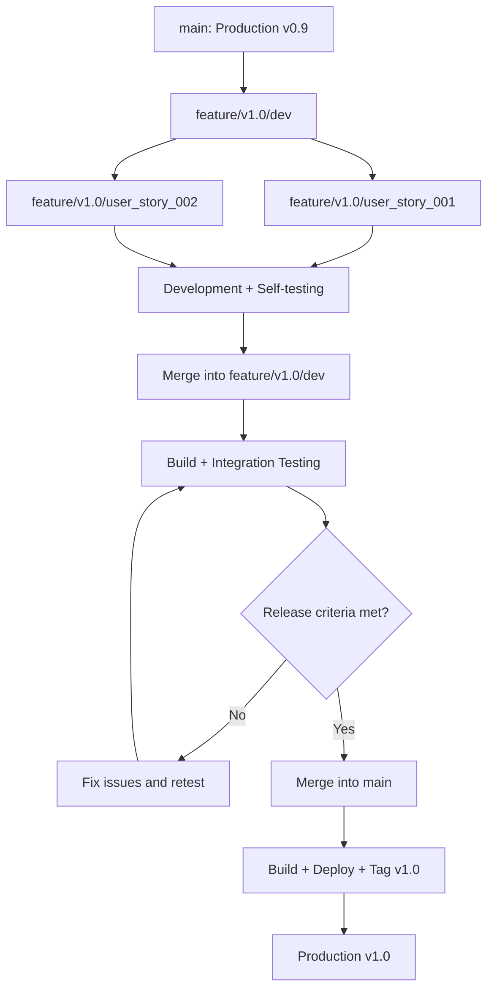
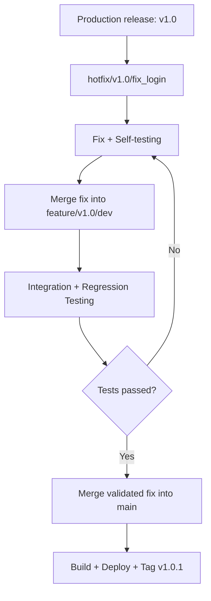

## Git Branch Management Strategy

### 1. Overview

The project uses a version-based Git branching strategy to manage feature development, integration testing, production releases, and hotfixes.

The `main` branch represents the latest successfully released production version and must always contain stable, deployable code.

### 2. Branch Structure

| Branch | Purpose | Created From | Merged Into |
|---|---|---|---|
| `main` | Stable, released production code | — | — |
| `feature/v[version]/dev` | Version integration and testing | `main` | `main` |
| `feature/v[version]/[branch_name]` | Individual feature development | Version `dev` | Version `dev` |
| `hotfix/v[version]/[branch_name]` | Production issue fixes | Production release tag or stable commit | Version `dev`, then release |

### 3. Branching Workflow



### 4. Production Hotfix Workflow

A production hotfix must start from the exact production release tag or stable commit. This prevents unreleased changes in a development branch from entering production.



**Important:** If the version development branch contains unreleased features, do not merge the entire branch into `main`. Instead, release only the verified hotfix changes, for example through a dedicated release branch or cherry-pick. Ensure the fix is also synchronized into active development branches.

### 5. Naming Conventions

- Production branch: `main`
- Version integration branch: `feature/v1.0/dev`
- Feature branch: `feature/v1.0/user_story_001`
- Hotfix branch: `hotfix/v1.0/fix_login`
- Release tags: `v1.0.0`, `v1.0.1`

### 6. Feature Development

1. Create a feature branch from the target version's integration branch.
2. Implement the feature and complete developer self-testing.
3. Submit a pull request targeting the version integration branch.
4. Complete code review and automated checks.
5. Merge the approved feature into the version integration branch.
6. Run integration testing and fix identified issues.

```bash
git switch feature/v1.0/dev
git pull origin feature/v1.0/dev
git switch -c feature/v1.0/user_story_001

# After development and testing
git push -u origin feature/v1.0/user_story_001
# Open a pull request targeting feature/v1.0/dev
```

### 7. Version Release

1. Freeze feature integration for the release candidate.
2. Run full integration and regression testing.
3. Confirm release readiness.
4. Merge the version integration branch into `main` through an approved pull request.
5. Build and deploy the production artifact.
6. After successful deployment, create a release tag.
7. Keep the released version branch available for maintenance when necessary.

### 8. Hotfix Release

1. Identify the exact production release tag or commit.
2. Create a hotfix branch from that production baseline.
3. Implement and self-test the fix.
4. Synchronize the fix into the version integration branch.
5. Complete integration and regression testing.
6. Release only the verified hotfix changes to `main`.
7. Deploy and create a patch-version tag.
8. Synchronize the fix into any newer active version branches.

```bash
git fetch origin --tags
git switch -c hotfix/v1.0/fix_login v1.0.0

# After implementing and testing the fix
git push -u origin hotfix/v1.0/fix_login
# Open PRs to synchronize and release the validated fix
```

### 9. Branch Protection Rules

- Direct pushes to `main` are prohibited.
- Changes to `main` require an approved pull request.
- Feature branches must pass self-testing and automated checks before merging.
- Version integration branches must pass integration and regression testing before release.
- Production hotfixes must not introduce unrelated or unreleased features.
- Every production release must have a Git tag.
- Released version branches must not be force-pushed or rewritten.
