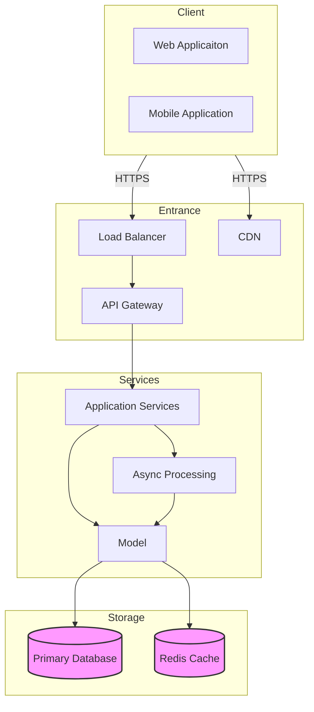

# Architecture

## 1. Client - Service - Permanent Storage

## 2. Tech-Stack

### Frontend 

- React + Next.js (~55% - 60%)

### Backend 

- Python + FastAPI

### Database

- PostgreSQL

### API

- RESTful API

## 3. Backend 

### Services

- Application Services + Domain + Repository / DAO

### Database

- PostgreSQL