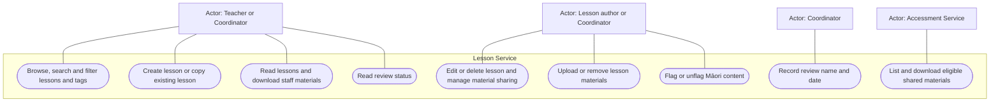
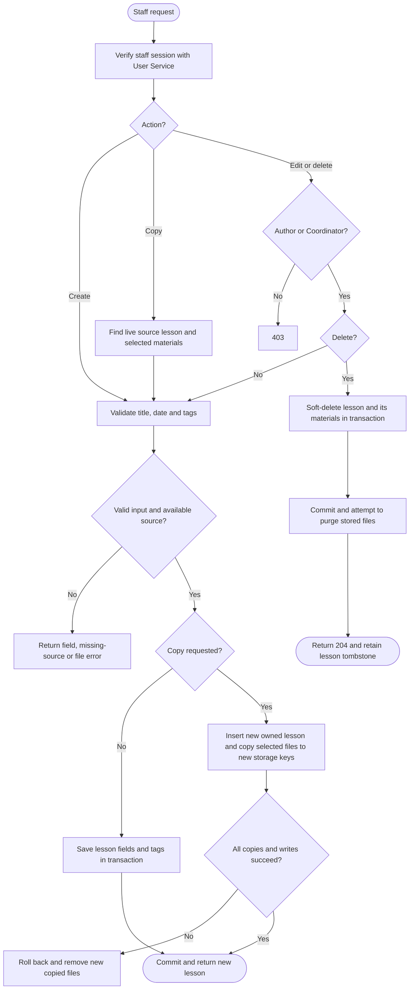
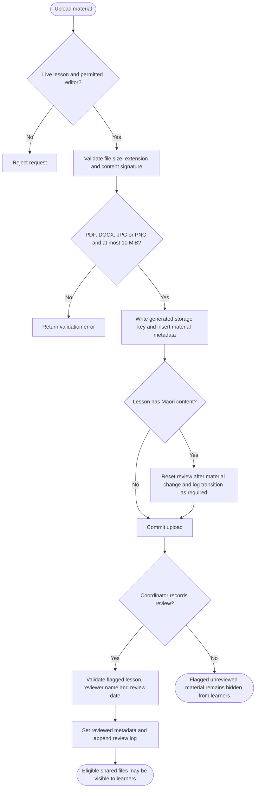
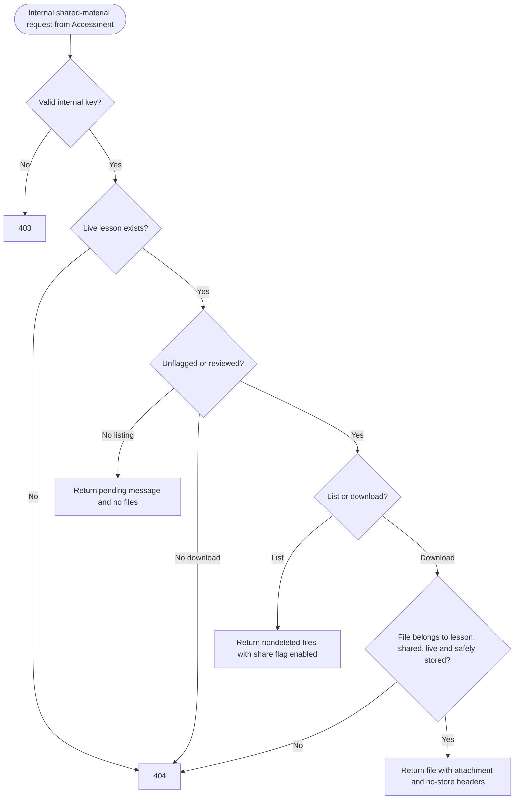
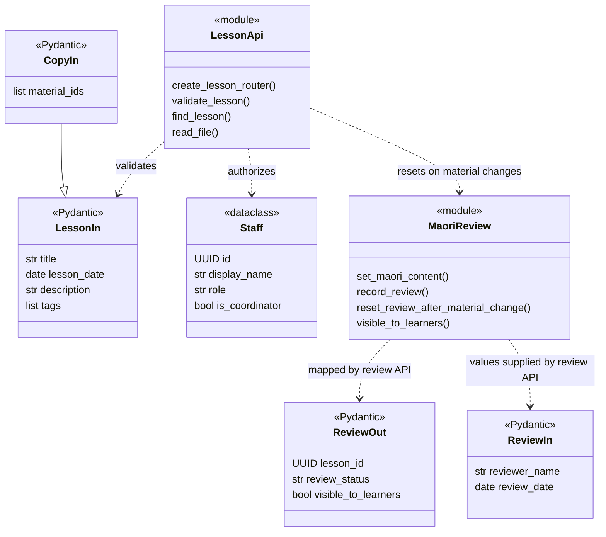
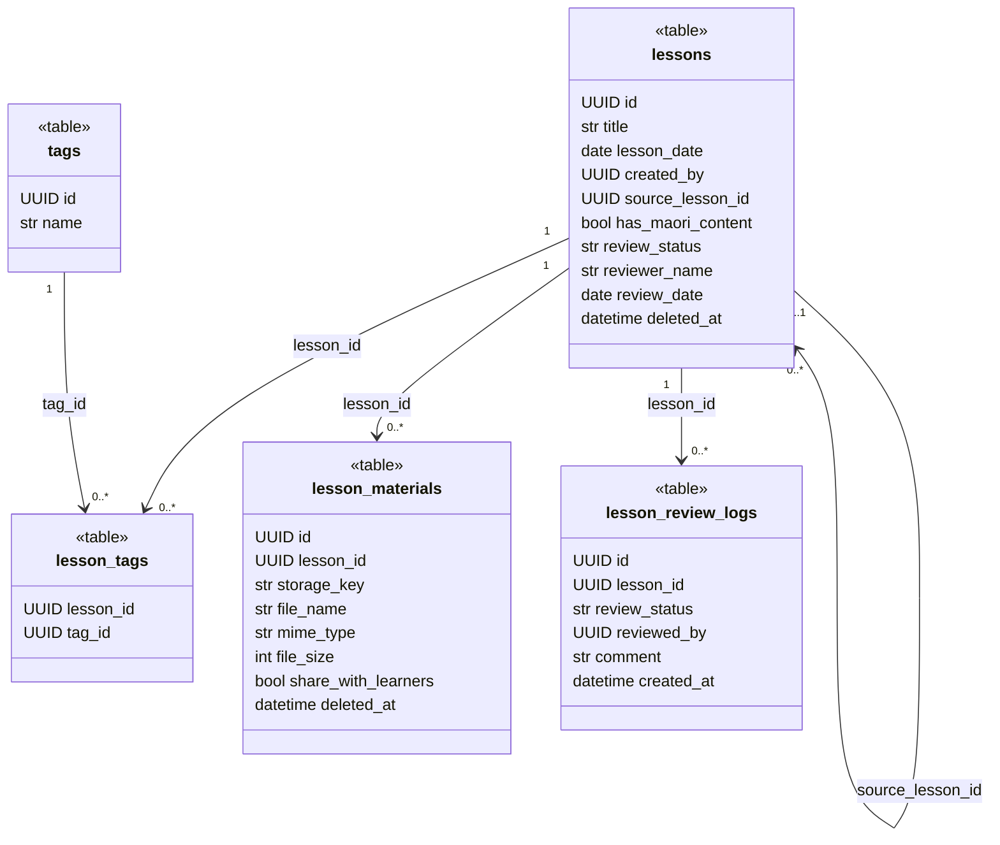

# Lesson Service UML

Source baseline: `feature/v1.0/pre_release`, commit `f5e63dd0ccacffa4f8f0d6d920b04a94d51302a4`.

Diagrams describe the implemented application, not every possible requirement. GitHub renders the Mermaid fences directly. Use cases use a Mermaid flowchart with actor nodes, oval use cases and a system boundary because Mermaid has no native UML use-case syntax. Activity diagrams use decisions and explicit outcomes. Class diagrams distinguish actual classes from `table`, `module`, `type` and `component` representations. Only selected fields and operations are shown; function-based modules are not implemented service classes. Dashed dependencies represent calls or logical references, not database foreign keys.

## Scope and source map

Source paths in this document are relative to [server/services/lesson](../../../server/services/lesson).

This service owns the lesson library, tags, uploaded files, copying and Māori content review metadata. It authenticates staff through User Service. Accessment Service supplies learner authorization and calls the internal shared-material routes.

| Area | Source |
| --- | --- |
| Lesson CRUD, search, tags and materials | `lesson_api.py` |
| Copying lessons and selected files | `lesson_copy.py` |
| Review rules and endpoints | `maori_review.py`, `maori_review_api.py` |
| Learner-visible material list and download | `shared_materials.py` |
| Staff identity and persistence | `user_client.py`, `models.py`, `schema.py` |

## Use Case Diagram

Teacher edits require lesson ownership; Coordinators may edit other authors' lessons. Copying creates a new lesson owned by the copying staff member. Review recording captures the supplied reviewer name and date; the system does not itself perform cultural review or verify the reviewer's qualifications. Internal material endpoints require the internal API key.

## Activity Diagrams

### Create, copy or edit a lesson

The source lesson is retained after a copy. `source_lesson_id` records provenance. A missing or deleted source is rejected. Soft-deleted lesson IDs may still be referenced by Accessment Service; reads and downloads check availability.

### Upload and review visibility

Upload failures roll back database writes and remove the new file. The review rule is also re-evaluated after material deletion. Unflagged lessons do not require review; flagged lessons require `reviewed` status for learner visibility. Sharing a file and recording a review are separate operations.

### Learner shared material request

This service does not accept a learner cookie as authorization. Accessment validates the learner grant and determines the associated lesson before calling these endpoints.

## Class Diagrams

### Routes and review implementation

### Local persistence model

These boxes represent SQLAlchemy tables. `created_by`, `uploaded_by` and reviewer IDs refer logically to User Service users; there are no cross-database foreign keys. Material bytes live in the configured filesystem, while metadata lives in the database. Database status constraints include `rejected`; no rejection action is exposed by `ReviewIn` in this branch.
