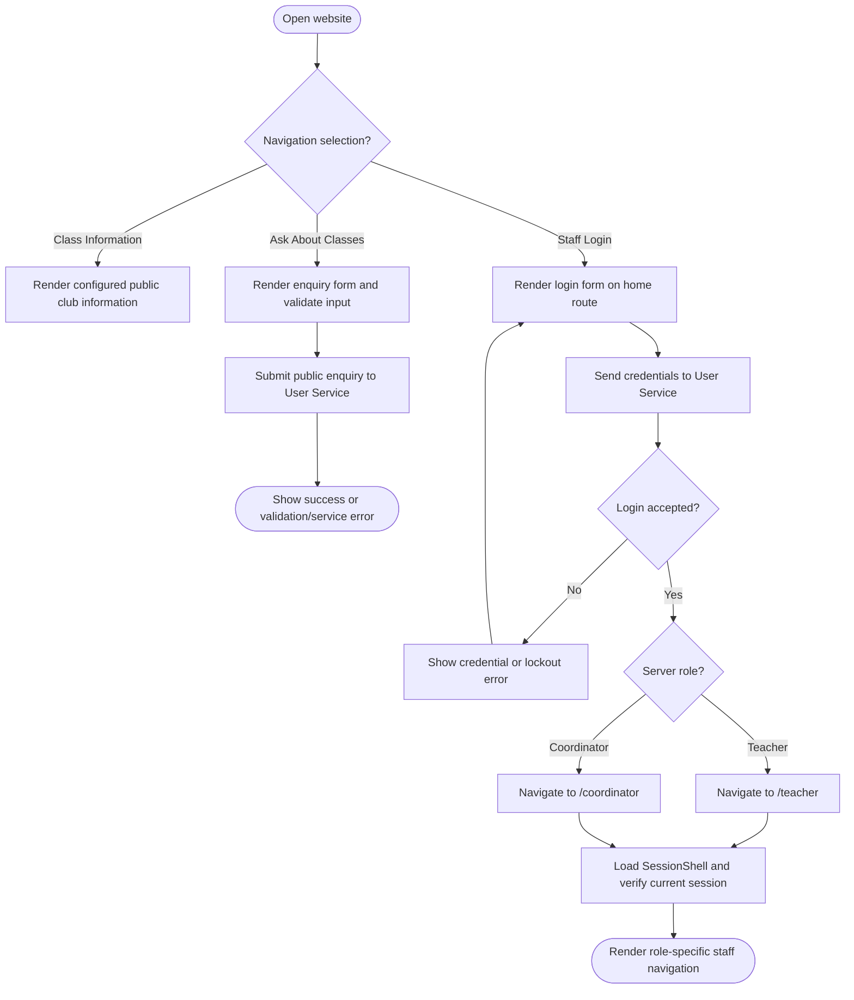
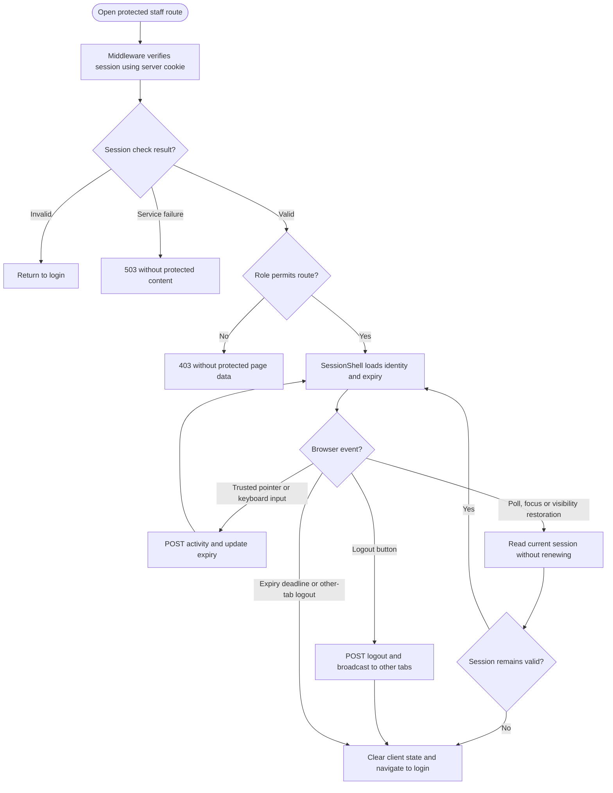
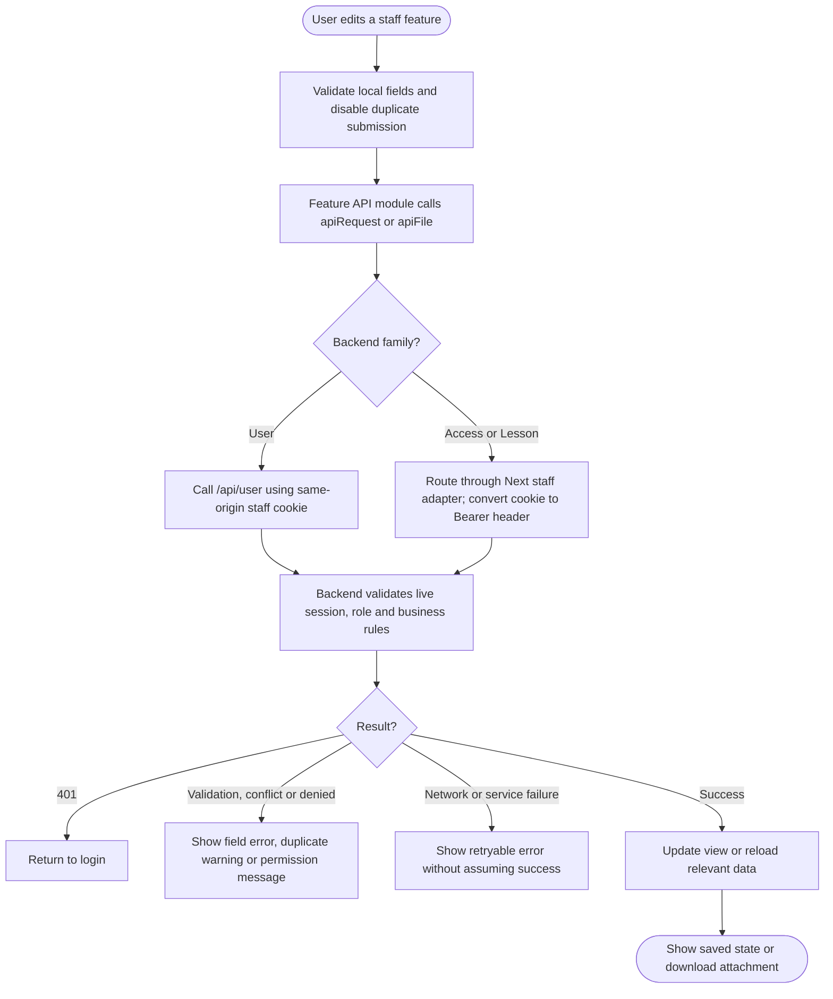
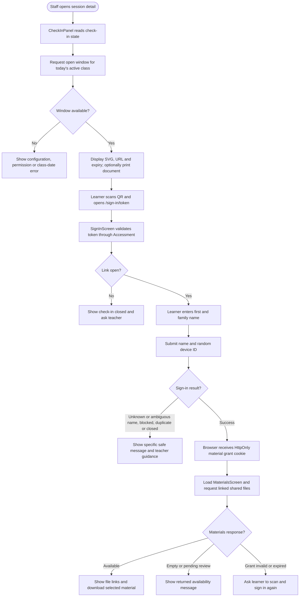
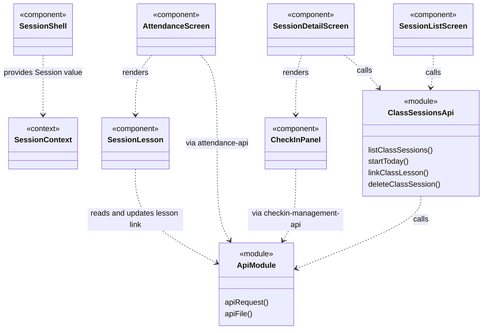
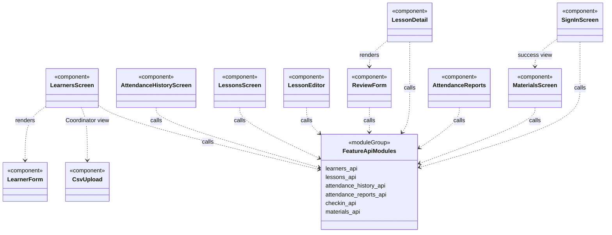
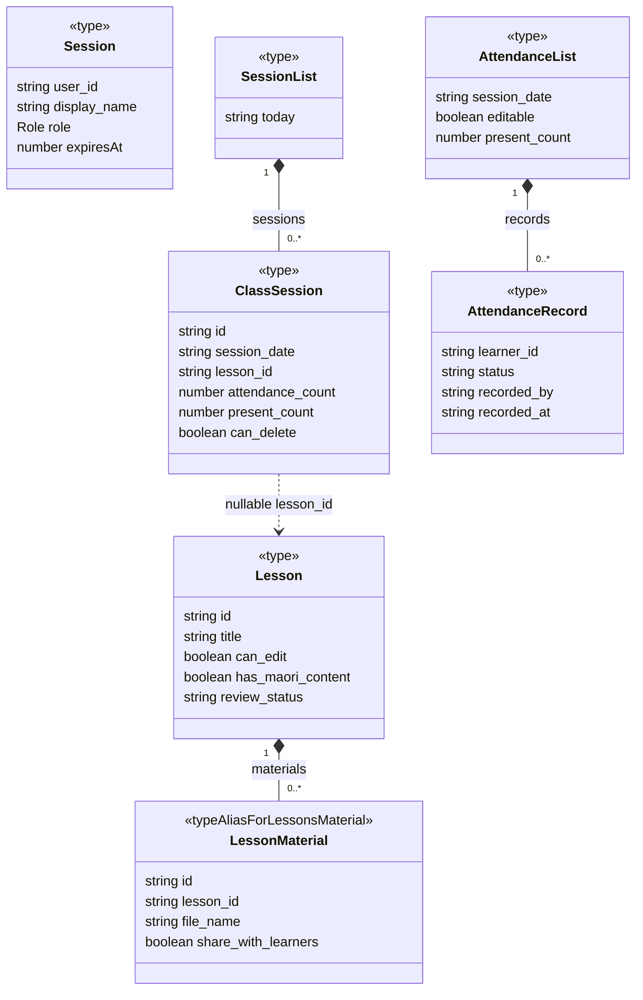
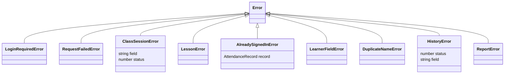

# Web Application UML

Diagrams describe the implemented application, not every possible requirement. GitHub renders the Mermaid fences directly. Use cases use a Mermaid flowchart with actor nodes, oval use cases and a system boundary because Mermaid has no native UML use-case syntax. Activity diagrams use decisions and explicit outcomes. Class diagrams distinguish actual classes from `table`, `module`, `type` and `component` representations. Only selected fields and operations are shown; function-based modules are not implemented service classes. Dashed dependencies represent calls or logical references, not database foreign keys.

## Scope and source map

Source paths in this document are relative to [web](../../../web).

The Next.js application presents public information, enquiries, staff login, staff administration, the lesson library, class sessions, attendance, QR management, learner material access and reports. It uses React function components and TypeScript data types. It does not own the backend databases.

| Area | Source |
| --- | --- |
| Public home, information and enquiries | `src/app/(auth)`, `src/components/club`, `src/components/enquiries` |
| Login, role navigation and session lifecycle | `src/middleware.ts`, `src/components/login-form.tsx`, `src/components/session-shell.tsx`, `src/lib/session.ts` |
| Staff sessions, learners, lessons and reports | `src/app/(staff)`, corresponding `src/components` folders |
| Public classroom sign-in and materials | `src/app/(public)`, `src/components/sign-in`, `src/components/materials` |
| Cookie-to-Bearer API adapters | `src/app/api/staff/access/[...path]/route.ts`, `src/app/api/staff/lesson/[...path]/route.ts`, `src/lib/api.ts` |
| UI styles and shared controls | `src/styles/ako`, `src/components/ako-controls.tsx` |

## Use Case Diagram

```mermaid
flowchart TB
  visitor["Actor: Visitor"]
  staff["Actor: Teacher or Coordinator"]
  coord["Actor: Coordinator"]
  learner["Actor: Classroom learner"]
  subgraph web["Web application"]
    public(["Open home, Class Information or Ask About Classes"])
    login(["Open Staff Login and authenticate"])
    learners(["Manage learners and view attendance history"])
    sessions(["Manage classes, lesson links and today's attendance"])
    lessons(["Browse, search, copy and manage permitted lessons"])
    qr(["Open, display, print or close check-in"])
    admin(["Manage Teacher accounts, import CSV and list enquiries"])
    reports(["Export attendance and correct past attendance"])
    review(["Record Māori content review"])
    signin(["Open QR link and submit learner name"])
    material(["View and download eligible class materials"])
    logout(["Log out or return to login after session ends"])
  end
  visitor --- public
  visitor --- login
  staff --- learners
  staff --- sessions
  staff --- lessons
  staff --- qr
  staff --- logout
  coord --- admin
  coord --- reports
  coord --- review
  learner --- signin
  learner --- material
```

The public navigation leads to separate content: `/`, `/class-information` and `/ask-about-classes`; Staff Login is presented on `/`. Staff landing pages are `/teacher` and `/coordinator`. The staff lesson editor additionally applies author/Coordinator permissions returned by the API. Feedback is not part of this baseline branch.

## Activity Diagrams

### Public navigation and staff authentication

### Protected page and session lifecycle

Middleware excludes framework prefetch requests from its session check. This does not authorize data access: `SessionShell` and backend endpoints perform their own checks. Periodic reads do not count as activity. `SessionContext` supplies identity to staff child components.

### Staff feature request and error handling

Feature screens include learner creation/editing and CSV results; lesson creation/editing/copying and review; session lesson association and deletion; attendance marking/correction; history filtering; and CSV/PDF report download. Server permission checks remain authoritative even when UI controls are hidden or disabled.

### QR management and learner material journey

Closing or expiring check-in prevents later sign-in; an already issued material grant has its own expiry. Materials also have a standalone `/materials` route. A duplicate attendance response does not establish a new material authorization cookie.

## Class Diagrams

### React components and API modules

These are component/module dependencies represented in class-diagram notation, not JavaScript class inheritance. Route page functions compose these components. Only major dependencies are shown.

`FeatureApiModules` is a diagram grouping of separate files, not an exported symbol. PublicFrame/PublicNavigation, LoginForm, StaffManagement and CoordinatorEnquiries supply the remaining public/authentication/administration views.

### TypeScript data contracts and actual error classes

`LessonMaterial` disambiguates the `Material` type in `lessons-api.ts` from the smaller public `Material` type in `materials-api.ts`; it is a diagram alias. Nullable values are simplified in the boxes; see the source types for exact unions. Data types represent API payloads, not persistent frontend entities.

Actual error classes translate backend statuses into UI behavior. Additional small error classes in the feature API files are omitted for readability. This diagram does not imply that the functional screens inherit from these classes.
