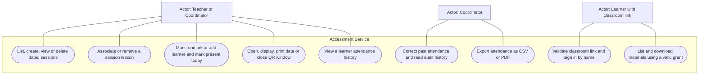
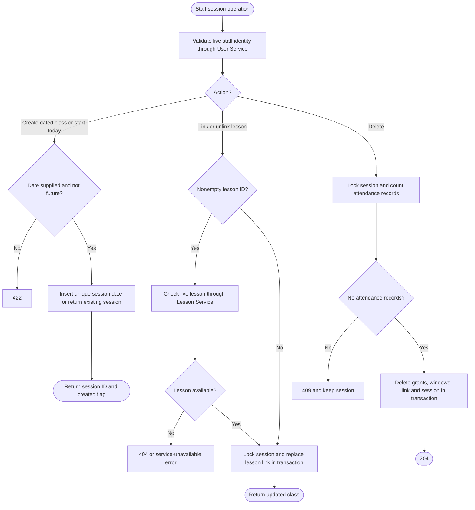
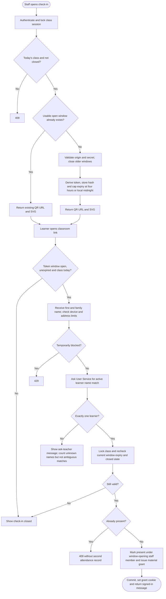
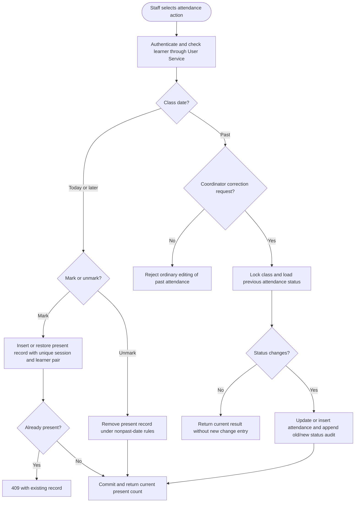
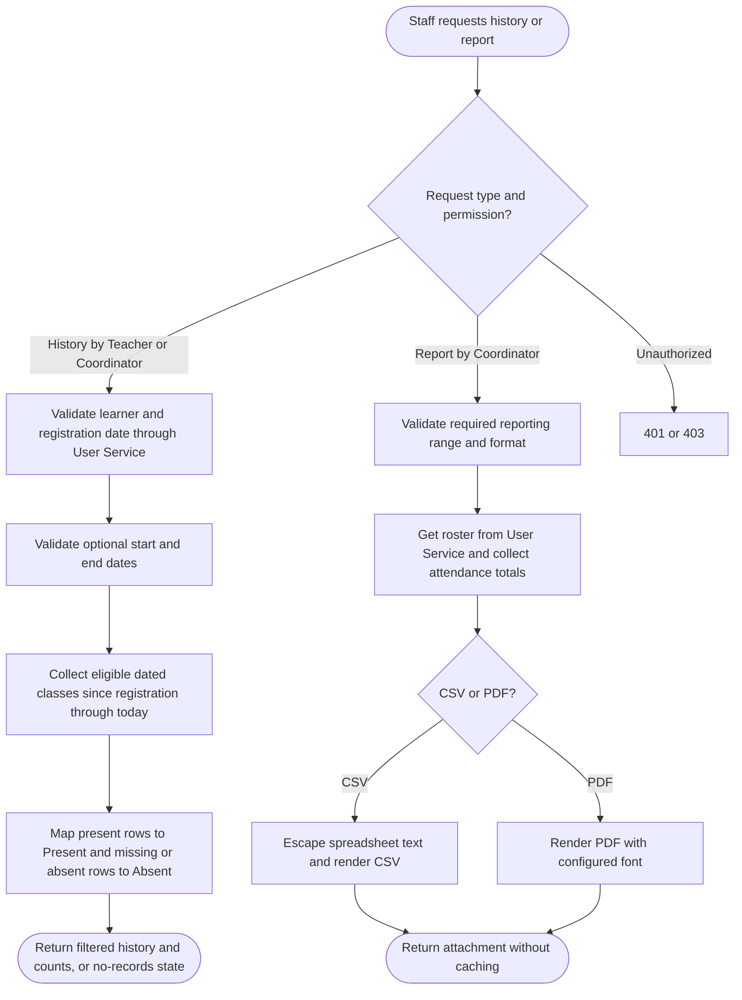
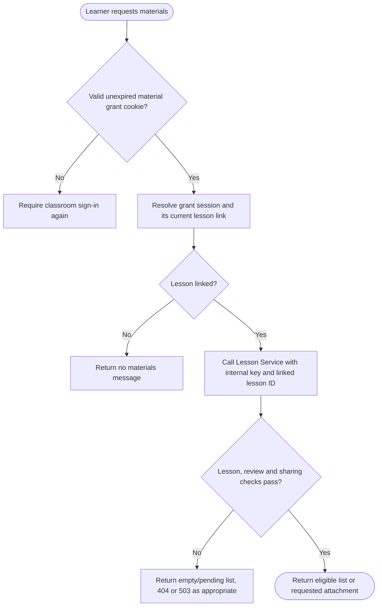
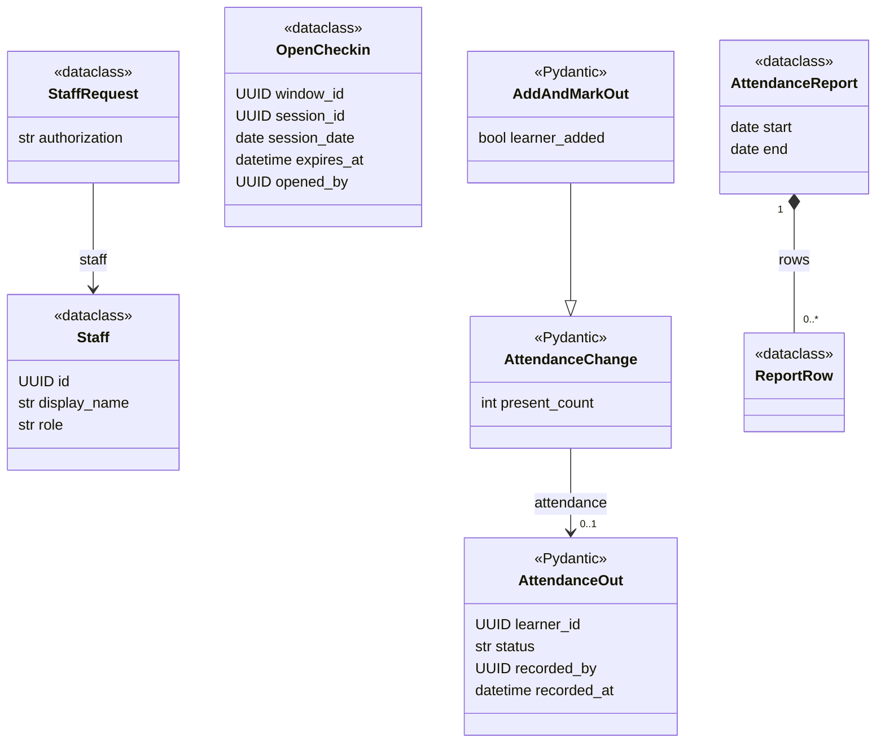
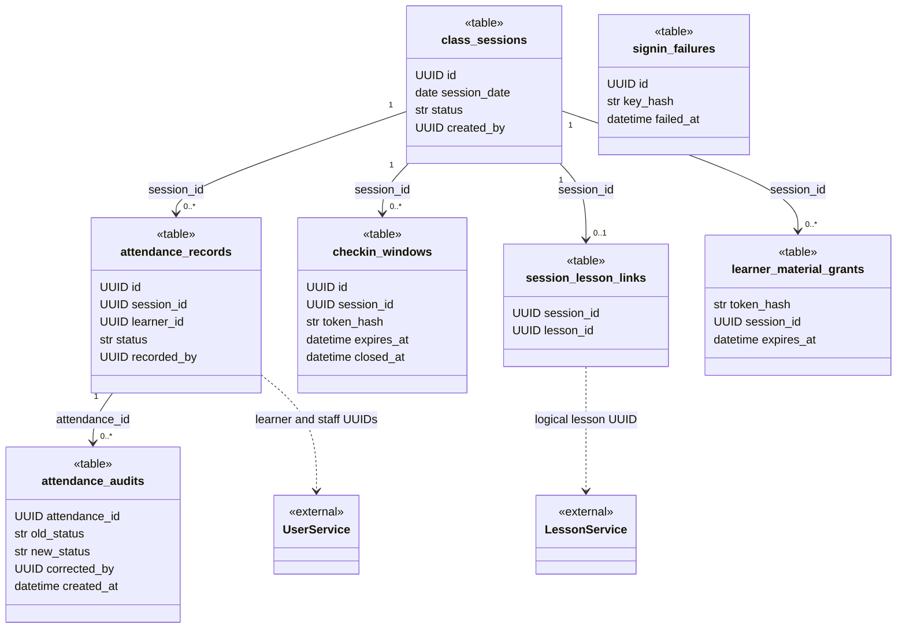

# Accessment Service UML

Source baseline: `feature/v1.0/pre_release`, commit `f5e63dd0ccacffa4f8f0d6d920b04a94d51302a4`.

Diagrams describe the implemented application, not every possible requirement. GitHub renders the Mermaid fences directly. Use cases use a Mermaid flowchart with actor nodes, oval use cases and a system boundary because Mermaid has no native UML use-case syntax. Activity diagrams use decisions and explicit outcomes. Class diagrams distinguish actual classes from `table`, `module`, `type` and `component` representations. Only selected fields and operations are shown; function-based modules are not implemented service classes. Dashed dependencies represent calls or logical references, not database foreign keys.

## Scope and source map

The directory retains the name `accessment`; its public gateway prefix is `/api/access`. It owns dated class sessions, attendance, QR windows, historical corrections, attendance history, reports and learner material grants. Staff identity and learner records come from User Service. Lessons and material bytes come from Lesson Service.

| Area | Source |
| --- | --- |
| Sessions and lesson association | `class_sessions.py` |
| Current attendance and past corrections | `app.py`, `attendance.py`, `corrections.py` |
| QR opening, expiry, closing and learner sign-in | `checkin_management.py`, `checkin.py`, `app.py` |
| Learner material grants | `learner_materials.py` |
| History and exports | `attendance_history.py`, `attendance_reports.py`, `report_client.py` |
| External clients and local tables | `user_client.py`, `lesson_client.py`, `models.py`, `schema.py` |

## Use Case Diagram

Staff includes both roles. Coordinator permissions for reports and corrections are checked by the service. Learners do not receive staff sessions. `/check` is a legacy demonstrator that compares a supplied role to `admin`; it is not the authorization mechanism for the business endpoints. QR printing itself is performed by the frontend using the returned SVG and URL.

## Activity Diagrams

### Session creation and lesson association

A session has at most one lesson association and its date is unique. Starting today's class does not require Lesson Service availability. Session creation permits a past date; ordinary attendance marking rejects past dates. The shared helper does not itself reject a future or closed class; normal class creation rejects future dates, while QR sign-in applies additional today/status checks.

### Open QR window and learner sign-in

Closing a window takes the same class lock as sign-in, so a stale validation cannot bypass closure. Unknown-name limits use keyed hashes, not stored raw addresses. Duplicate sign-in returns a conflict and does not issue a fresh material grant in that branch. Attendance and grant creation share the final local transaction; name matching occurs remotely first.

### Manual attendance and historical corrections

The add-and-mark operation first creates or finds a learner through User Service, then records attendance locally. These are separate service transactions; learner creation is not rolled back if the later local attendance write fails. Corrections preserve history through append-only database triggers.

### History and attendance report

History first determines whether any eligible attendance row exists for that learner; only then does it expand the class list, treating missing rows as absent. This is the implemented reporting interpretation, not proof of explicit absence entry at every class.

### Learner material access

Grants last 24 hours, are stored only as token hashes, and are scoped to a session rather than an authenticated learner account. Downloads resolve the current lesson association and reapply sharing/review rules.

## Class Diagrams

### Actual request, domain and report classes

### Local persistence and logical external references

All local entities above are SQLAlchemy tables, not ORM classes. `(session_id, learner_id)` is unique. External learner, staff and lesson IDs have no cross-database foreign keys. `signin_failures` is intentionally not linked to learner or session identity. The session-to-lesson link may exist with a null lesson ID.
