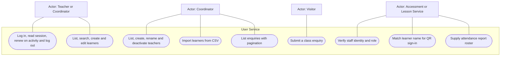
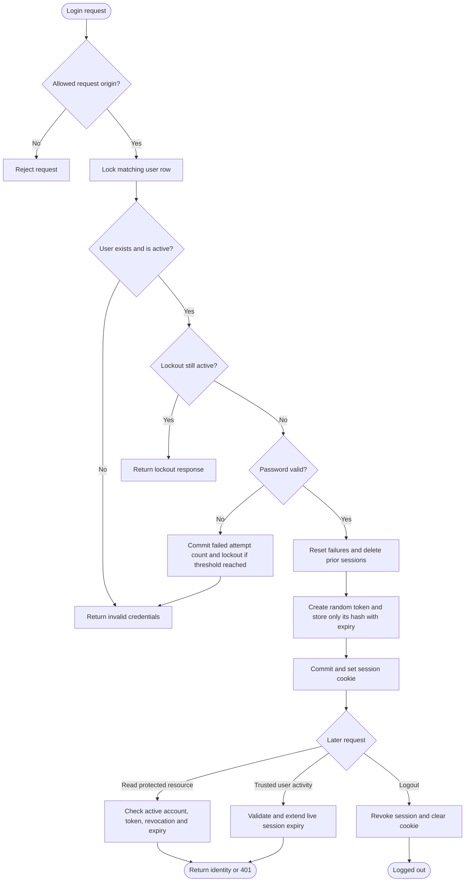
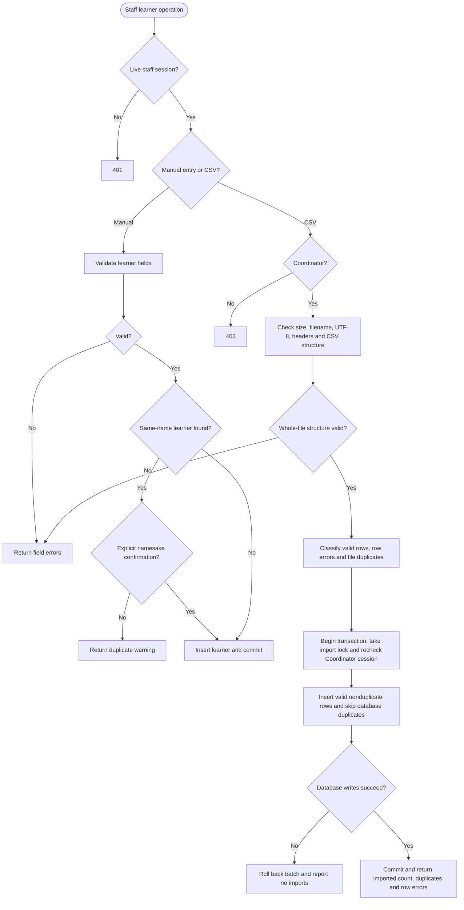
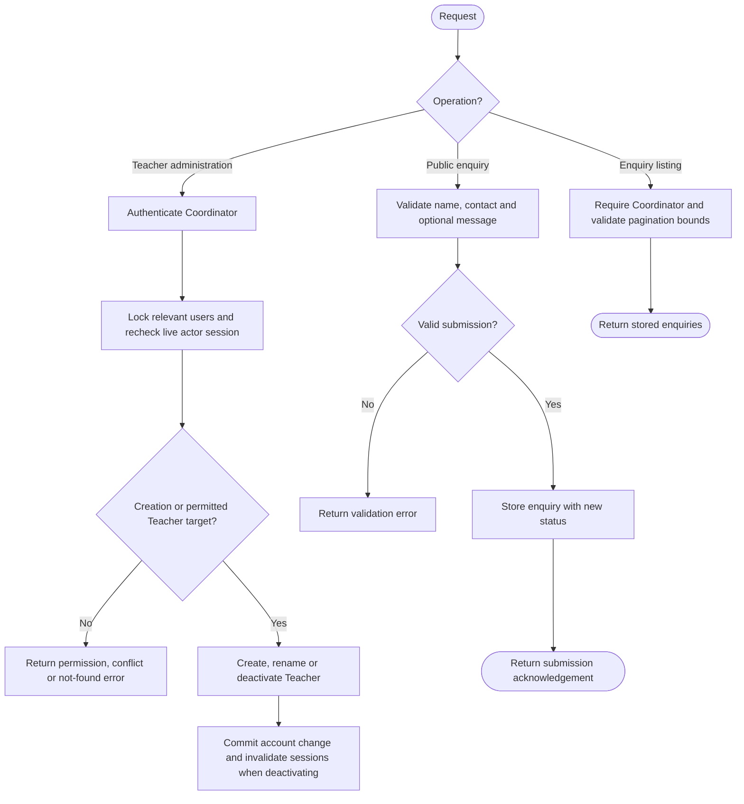
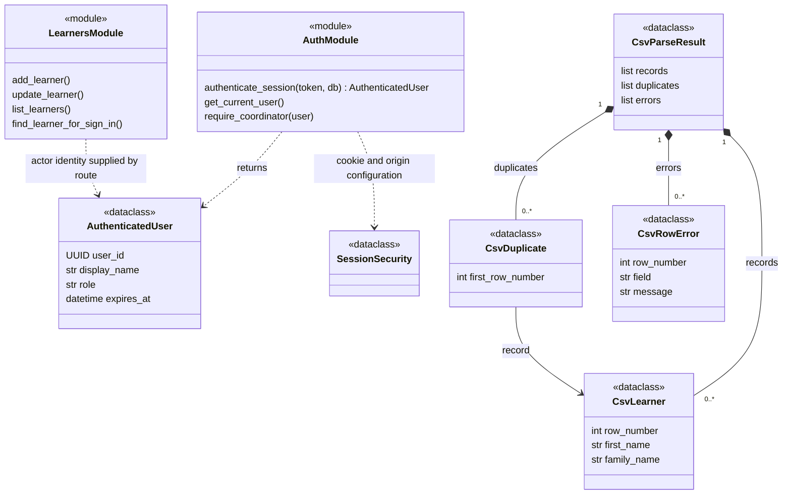
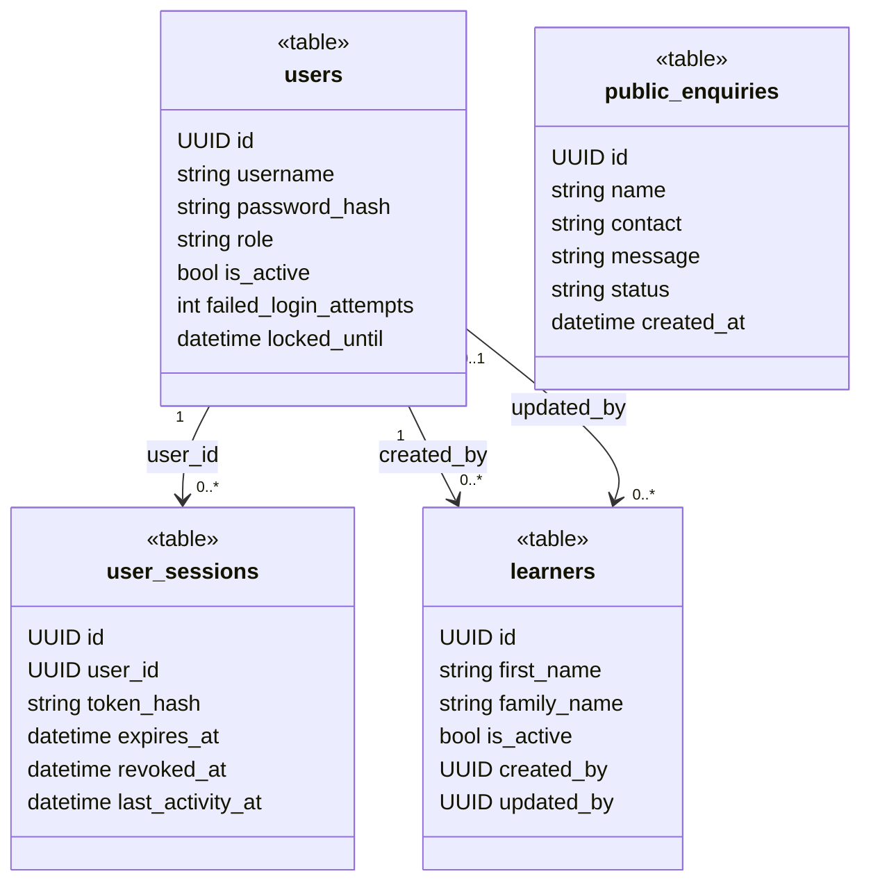

# User Service UML

Source baseline: `feature/v1.0/pre_release`, commit `f5e63dd0ccacffa4f8f0d6d920b04a94d51302a4`.

Diagrams describe the implemented application, not every possible requirement. GitHub renders the Mermaid fences directly. Use cases use a Mermaid flowchart with actor nodes, oval use cases and a system boundary because Mermaid has no native UML use-case syntax. Activity diagrams use decisions and explicit outcomes. Class diagrams distinguish actual classes from `table`, `module`, `type` and `component` representations. Only selected fields and operations are shown; function-based modules are not implemented service classes. Dashed dependencies represent calls or logical references, not database foreign keys.

## Scope and source map

The User Service owns staff authentication, teacher account administration, learner records, CSV import and public enquiries. Public club information is frontend content. Learners have no login accounts. Enquiries do not automatically create learners.

| Area | Source |
| --- | --- |
| Login, current session, activity and logout | `app.py`, `auth.py`, `security.py` |
| Teacher account administration | `staff.py`, `staff_service.py`, `init_coordinator.py` |
| Learners and CSV import | `learners.py`, `learner_csv.py`, `learner_import.py` |
| Public enquiries and reporting roster | `enquiries.py`, `report_roster.py` |
| Local database tables | `models.py` |

## Use Case Diagram

Staff means Teacher or Coordinator. Coordinator-specific operations are attached separately. Internal clients must satisfy the authentication of the corresponding endpoint.

`/me` validates a live staff session. `/internal/learners/match` requires the internal key. Reporting roster access is Coordinator-only. Teacher administration does not allow changing a Coordinator account or assigning arbitrary roles. The coordinator bootstrap command is an operator task, not a public registration use case.

## Activity Diagrams

### Staff login and session lifecycle

A new login replaces the old session. Reading a session does not renew it. Mutation protection and cookie configuration are implemented in `security.py` and `auth.py`; database-derived roles remain authoritative.

### Learner creation and CSV import

Malformed file structure rejects the file. Field-invalid rows can be reported while valid rows are imported together. The advisory lock serializes CSV imports across replicas; it is not a global lock on manual learner writes.

### Teacher administration and public enquiry

Enquiry status values exist in storage, but this branch does not expose a status-update workflow. The diagram therefore shows submission and listing only.

## Class Diagrams

### Authentication and learner import implementation

### Local persistence model

These are SQLAlchemy `Table` objects, not ORM entity classes. Multiplicities describe local foreign-key relationships. `created_by` and `updated_by` are separate learner-to-user references.

The database permits only one unrevoked session per user. An enquiry has no learner foreign key. Namesakes may be explicitly accepted during manual entry, so learner names are not unique database identifiers.
